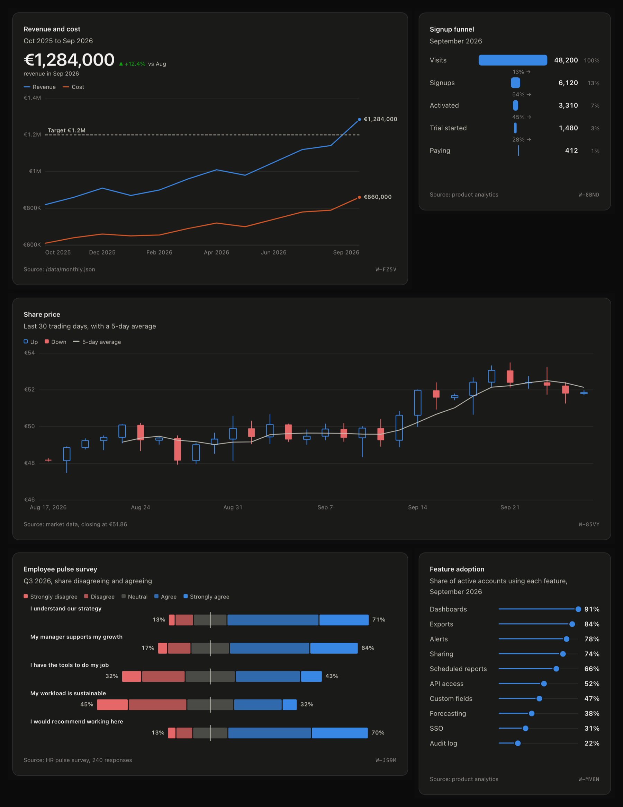

# FFT Widgets

One universal widget block that you fork into any chart, table, list or KPI.

A widget is a single plain object, the **spec**. It says where the data comes from, how to reshape it, how to draw it, and how it looks. The same spec draws in the browser, validates in Node, and is readable and editable by agents through the bundled MCP server.

```
 data          transform              fields               view              style
 where rows -> reshape rows        -> labels and formats -> how rows are  -> theme, palette,
 come from     (filter, sort,         per field            drawn            tokens, size
               aggregate, calc...)                         (table, bar...)
```

Every slot takes a **block**: `{ "type": "...", ...options }`. Blocks live in a registry, so adding a new data source, transform, format or view is one `register*` call, and every existing widget can use it.


Every card above is the same component fed a different spec from `widgets/`. Each one has a dark look that follows the theme:



## Quick start

Needs Node 23.6 or later (it runs TypeScript directly, with no build step).

```bash
npm install
npm run dev        # demo gallery at http://localhost:5173; its Playground (header button, or Edit in playground on any card) opens as a modal
npm test           # unit and integration tests
npm run typecheck
npm run smoke      # starts the real MCP server and calls it as a client would
npm run build:lib  # the drop-in bundle in dist/
npm run catalog    # the chart catalog and data guide: catalog/*.json, catalog/index.html, catalog/guide.html, docs/catalog.md, docs/chart-guide.md
npm run build:site # the whole site in dist-demo: the demo pages, plus the catalog, data guide and drop-in pages with what they load
```

## The site

The demo is eleven pages, linked from one row at the top of each:

| Page | What it is |
| --- | --- |
| Gallery (`index.html`) | Every example widget on one dashboard, with filters, sections and cross-filtering |
| Taller, Selected | New versions of any widget, and the ones worth keeping |
| Playground | Edit any widget's spec with a live preview (a panel over the gallery) |
| Editor | Make a chart from a table without writing JSON |
| Commercial, Client health, Regulatory | The three worked dashboards below |
| Catalog | All chart types, each drawn from its own spec, with what it needs and a spec to copy |
| Data guide | The table each chart needs, checked against its data, and what changes if you switch chart |
| Drop-in | Every way to put a chart on a page with one tag and no build step |

`npm run dev` serves them all. `npm run build:site` builds them into `dist-demo/` for any static server: Vite builds the demo pages, and `scripts/site-pages.ts` copies the catalog, data guide and drop-in pages with the specs, docs, styles and bundle they load. A test checks that every page in the navigation, and everything it loads, is published.

## Drop it into any page

`npm run build:lib` writes two self-contained files with no dependencies: `dist/martcharts.iife.js` (a classic script, exposed as `window.MartCharts`) and `dist/martcharts.js` (an ES module, also `import "martcharts/standalone"`). Both register `<fft-widget>` on load, so a page needs no bundler, no Node and no JavaScript of its own. Type declarations ship in `dist/types` (`martcharts/standalone` resolves them under any `moduleResolution`, and `document.querySelector("fft-widget")` comes back typed). The module is safe to import on a server too: it only registers the tag where `customElements` exists.

```html
<script src="martcharts.iife.js"></script>

<fft-widget data="sales.csv"></fft-widget>                   <!-- just data: the chart is picked for you -->
<fft-widget src="catalog/funnel.json"></fft-widget>          <!-- a spec file -->
<fft-widget actions="csv image">                              <!-- or the spec inline -->
  <script type="application/json">
    { "data": { "type": "inline", "rows": [{ "team": "Ops", "hours": 3 }, { "team": "Sales", "hours": 5 }] },
      "view": { "type": "hbar", "label": "team", "value": "hours" } }
  </script>
</fft-widget>
```

The [chart catalog](docs/catalog.md) has all <!-- views -->57<!-- /views --> views, each with what it is for, the data it needs and a self-contained spec in `catalog/` to start from. [examples/drop-in.html](examples/drop-in.html) shows every way in: inline, `src`, and a spec set from JavaScript with live data. [docs/frameworks.md](docs/frameworks.md) says how to get it into another project (copy one file, or `npm install` from GitHub) and has recipes for React, Vue, Svelte and server-rendered apps.

## A widget in one object

```json
{
  "id": "revenue-by-region",
  "title": "Revenue by region",
  "subtitle": "Q3 2026, all products",
  "source": { "name": "Finance ledger" },
  "locale": "en-US",
  "data": { "type": "url", "url": "/data/sales.json", "path": "data.items" },
  "transform": [
    { "type": "aggregate", "groupBy": "region", "measures": [{ "op": "sum", "field": "revenue" }] },
    { "type": "sort", "field": "revenue", "order": "desc" }
  ],
  "fields": { "revenue": { "label": "Revenue", "format": { "type": "currency", "currency": "EUR" } } },
  "view": { "type": "bar", "x": "region", "y": "revenue" },
  "style": { "theme": "auto" }
}
```

Draw it with JavaScript:

```ts
import { createWidget } from "martcharts";

const widget = createWidget(document.querySelector("#slot")!, spec);
await widget.ready;
widget.update({ view: { type: "table" } }); // same data, now a table
```

or with the HTML tag:

```html
<script type="module">
  import { defineWidgetElement } from "martcharts";
  defineWidgetElement();
</script>
<fft-widget src="/widgets/revenue-by-region.json"></fft-widget>
```

## Forking

`baseWidget` is the vanilla block: valid, empty, drawn as a table. Every widget is a fork of it, or of another widget. A fork says only what changes, using JSON Merge Patch rules: objects merge, lists replace, `null` removes a key.

```ts
import { baseWidget, fork } from "martcharts";

const topCustomers = fork(baseWidget, {
  title: "Top customers",
  data: { type: "url", url: "/data/customers.json" },
  transform: [{ type: "sort", field: "revenue", order: "desc" }, { type: "limit", count: 5 }],
  view: { type: "list", label: "name", detail: "country", value: "revenue" },
});

const asTable = fork(topCustomers, { view: { type: "table", label: null, detail: null, value: null } });
```

## What is built in

| Slot | Blocks |
| --- | --- |
| Data sources | `inline`, `url`, `fn` |
| Transforms | `filter`, `sort`, `limit`, `aggregate` (including `list`, for spark columns), `pivot` (long to wide), `calc`, `bin` (value bands with counts), `rag` (numbers to Red, Amber, Green statuses against thresholds, with an overall worst-of column) |
| Formats | `number`, `currency`, `percent`, `date`, `badge` (status pills), `spark` (mini trends in table and list cells), `bar` (in-cell data bars scaled to the column), `delta` (signed changes with an arrow, good or bad), `heat` (cells tinted on one shared scale, for heat tables), `rag` (a status pill with its shape and words: On track, At risk, Off track), `text` |
| Views | <!-- views -->57<!-- /views --> of them, grouped by the question they answer in [Which view?](#which-view) |
| Emphasis | `highlight` keeps the named categories or series in color and greys the rest, on every view that has categories or series to name; `colors` fixes a category's color on every chart |
| Combo | `"lines": "target"` on a bar chart draws lines over the bars on the same axis (never a second one); under a target line, bars that fall short are drawn outlined and keyed Below target; `"compare": "lastYear"` stands a wider, quieter column behind each bar |
| Two units | `dual`: two measures in different units (revenue and churn) on two panels sharing one time axis, each on its own scale, as bars or lines. The honest form of a dual-axis chart: no second axis, so no false crossings |
| Notes | `"annotations": [{ "x": "2026-03", "text": "Price rise" }]` on bar, line and area pins short notes to points, each a few words beside a dot with a thin leader; on a narrow card they become numbered markers with the texts listed under the chart |
| Line marks | `"points": true` draws a symbol at every reading; `"labels": "peaks"` names the highest and lowest point; `"scale": "log"` draws the value axis by powers of ten, for growth that multiplies |
| Part-to-whole | `"stacked": true` or `"percent"` on bar and hbar charts; `donut` for up to 6 slices |
| Reference marks | `"reference": [{ "value": 1200000, "label": "Target" }]` draws target lines and bands on bar, line, area and scatter charts |
| Dashboards | `createDashboard(el, spec, { widgets })` lays out widgets from one JSON file, with a filter row that scopes every widget with that field, a Period control (`"range": { "field": "month" }`: 3M, 6M, 12M, YTD, All) and full-width section headings (`{ "section": "Revenue" }`) with a section filter (All, or one section at a time) |
| Text templates | Titles, subtitles, footers and headline captions can say `{first:month} to {last:month}`, `{count} deals` or `{sum:revenue}`, filled from the rows the chart draws |
| Export | `createWidget(el, spec, { actions: ["csv", "image", "copy"] })` adds download CSV, download PNG and copy-for-Excel buttons. Past three actions, the first two stay in the toolbar and the rest go into a labelled More menu (arrow keys, Escape) |
| How to read it | The `explain` action (a question mark in the toolbar) shows a plain guide under any chart, and the expanded view shows it from the start; `board.setGuides(true)` (or the `guides` option) opens every guide on a dashboard at once. `explainChart(spec, rows)` gives every one of the <!-- views -->57<!-- /views --> views a plain reading guide in the chart's own field names, simple enough for a ten-year-old: "Each dot is one account. Further right means more revenue growth; higher means more gross margin. Bigger dots mean more revenue." |
| Accessibility | Conforms to EN 301 549 v3.2.1 (European Accessibility Act), that is WCAG 2.1 AA, plus WCAG 2.2 target size and focus not obscured: keyboard reach for every mark, a data table behind every chart, 4.5:1 text and 3:1 marks in every theme and preset, color never the only signal, Escape-dismissable tooltips. See [docs/accessibility.md](docs/accessibility.md) |
| Taller | `createVariants(spec, rows, { seed, moves, audience, color, marks })` applies elBulli's creative method, abstracted and aimed at sales, to any widget: seeded new versions with the same numbers, each saying which sales question it answers ("Which region has the most revenue?") and made by one of seven sales moves (decompose, reframe, distill, contrast, reveal, combine, reform). Each is valid, colorblind safe, never a copy, scored on emphasis, surprise, honesty, detail and insight, with a plain title and how to read it. `rankVariants` sorts them by novelty or meaning; `questionOf(spec)` words any chart's sales question. The demo has its own page, `taller.html`; see [docs/taller.md](docs/taller.md) |
| Line texture | `"curve": "smooth"` (never swings past a point) or `"step"` on line and area charts |
| Widget refs | Every widget with an id wears a faint ref such as `W-7Q2K` in its bottom corner (`widgetRef(id)`, stable, easy to say). Click to copy it; the MCP tools take it in place of the id, so "fix W-7Q2K" is enough |
| Small multiples | `"facet": { "field": "region" }` splits any chart into one panel per value, on one shared scale |
| KPI icons | `"icon": "users"` and 13 more line icons on KPI tiles |
| Direct labels | Lines and areas write each series' last value at its end (up to 4 series, hidden when ends collide) |
| Headline | A big number with its change and a caption above any chart: `"headline": { "value": "revenue", "compare": "previous" }` |
| Maps | `"geo": "europe"` or `"geo": "us-states"` puts rows on a built-in tile grid by their country or state code (every region the same size, so Luxembourg reads like France); `"geo"` also takes a GeoJSON FeatureCollection or its address for true shapes, with `lat` and `lon` for points. No dependencies, no tiles, no keys |
| Style presets | `default`, `glass` (frosted translucent cards: light frost or dark smoke), `airy` (chrome-free editorial), `paper` (print: warm paper, serif titles, a rule over each card; a night edition on dark). Every preset has a light and a dark look that follow the theme, each with its palette stepped for its surface |
| Palettes | `default`, `apple`, `credit-agricole`, `bw`, `50-shades`, five acclaimed ones with their exact published colors (`okabe-ito`, `tol-vibrant`, `tableau-10`, `carbon`, `observable-10`), or any list of colors. Every named palette has a light and a dark set: its own where published (Default, Apple, Carbon), otherwise derived with the same hues moved into the dark band (greys flip), and charts switch with the theme; `createPalettePicker` chooses them with an eyedropper and live colorblind checks |

Every option of every block is listed in [docs/blocks.md](docs/blocks.md), generated from the code.

## Which view?

Start from what you want the reader to see. Every view takes plain rows; `suggestView(type, rows)` fills a view's options from the data, so switching between candidates costs nothing. Each of the <!-- views -->57<!-- /views --> views appears once below.

| You want to show | Views |
| --- | --- |
| One number and how it moved | `kpi` (one figure, its change and a sparkline), `kpis` (a row of them), `gauge` (one figure on a known scale). Any tile takes `"rag"` thresholds for an On track, At risk or Off track pill; any chart takes a `headline` |
| Progress to a goal | `meter` (one bar per goal), `bullet` (with poor, fair and good bands), `rings` (a few goals at once). Each says where it stands: Target met, or how far it has to go |
| A ranking or a comparison | `hbar` (labels on the left; several values make grouped, stacked or split bars; `"mark": "lollipop"` for many similar values), `dot` (several measures per item on one axis), `dumbbell` (a before and an after; `"mark": "arrow"` points the way each moved), `slope` (who moved between two periods) |
| Change over time | `line`, `area` (`"stacked": "stream"` for a streamgraph; `"forecast"` and `"band"` for a forecast fan), `bar` (`"compare"` stands last year behind each bar), `calendar` (day by day), `candlestick` (open, high, low and close) |
| Two measures in different units | `dual` (one panel each, sharing the time axis: the honest dual-axis chart) |
| Many time series at once | `horizon` (a thin row per series, values folded into bands of deepening color) |
| Rank over time | `bump` |
| A cycle that wraps round | `rose` (hours of the day or months of the year, wedges true to their values by area) |
| Patterns across two dimensions | `heatmap` (one shaded cell per pair, such as weekday by hour), `matrix` (a mark per pair, sized and shaded; or a square where a flag is yes, such as who must comply) |
| Parts of a whole | `pie` (shares on the slices), `donut` (up to 6 parts, the total in the middle; `"arc": "half"` for seats and a majority line), `waffle` (100 countable squares), `treemap` (many parts), `sunburst` (two or three levels), `icicle` (a hierarchy laid flat, easier to label) |
| Size and mix at once | `marimekko` |
| What makes up a change | `waterfall` (a bridge from one total to the next), `variance` (actual against plan, good or bad) |
| Where the bulk is | `pareto` (the vital few behind 80%) |
| How values spread | `histogram`, `boxplot` (quartiles and outliers), `beeswarm` (every point), `ridgeline` (shapes side by side) |
| Two groups across ordered bands | `pyramid` (women and men by age group, two counts back to back) |
| How two measures relate | `scatter` (`"size"` for bubbles; `"quadrants"` names four corners; `"cluster"` draws soft areas round each group) |
| Profiles across several attributes | `radar` (up to 3 profiles on one shared scale) |
| Flows between stages | `sankey` (branching), `funnel` (one path), `chord` (exchange within one set) |
| Survey answers | `likert` |
| Plans, stages and status | `timeline` (tasks and milestones, a today line), `lifecycle` (each item's stages from proposal to application on one date axis), `board` (one column per stage, each item a card) |
| Where things are | `choropleth` (regions shaded by a value, or colored by a category), `symbols` (circles sized by a value), `locator` (named places with their labels), on the built-in `europe` or `us-states` grids or your GeoJSON |
| Counted units and how binding they are | `strips` (one square per provision, colored by part, with the density per page) |
| What stepped out of line | `anomalies` (one lane per metric, its expected band behind it, the days outside it flagged) |
| Who is on track, red, amber or green | `ragboard` (a scorecard, worst first, with the move since last period), `ragtrend` (each status period by period, and why it changed) |
| One client, and where to sell next | `whitespace` (the cross-sell map: held, open by propensity, not eligible), `xray` (one client on one card), `history` (every touchpoint, newest first) |
| Records to read | `table` (sortable; search, pages, a pinned first column, and sparkline, status pill, in-cell bar, heat and RAG cells), `list` |

Clicking a mark on a dashboard filters every other chart that shares its field, with a chip to clear it. Every card exports whole, title to credit line, as PNG or SVG. Option names are the same across views (`value` for the measure, `color` for color by category, `flag` for a yes/no field); older spellings still work and say once what they are now called.

Charts follow fixed rules: a validated, colorblind-checked 8-color palette with its own dark-mode set, bars at most 21px wide with rounded data ends, 2px lines, hairline gridlines, a legend only when there are two or more series, a tooltip on hover and keyboard focus, and a hidden data table for screen readers.

The visual system uses Fibonacci framing: spacing in steps of 2, 3, 5, 8, 13, 21 and 34 px, type at 11, 13, 21 and 34 px, motion at 377, 610 and 987 ms, and golden-ratio proportions (charts are φ times wider than tall, bar groups fill 0.618 of their slot). A one-word `style.preset` switches the whole look.

## The MCP server

Every widget is linked to an MCP server, so an agent can read its data, explain it, change it or fork it.

```bash
npm run mcp                                   # all widgets in ./widgets
node src/mcp/main.ts --widget revenue-kpi     # a server linked to one widget
npm run mcp:config                            # print an .mcp.json with one server per widget
npm run mcp:inspect                           # open the MCP Inspector against it
```

This folder's `.mcp.json` already registers the all-widgets server, so Claude Code picks it up when opened here. Tools: `fft_list_widgets`, `fft_get_widget`, `fft_get_widget_data`, `fft_create_widget`, `fft_update_widget`, `fft_delete_widget`, `fft_list_charts` and `fft_get_chart` (the chart catalog, with starter specs), `fft_chart_guide` and `fft_switch_chart` (the table each chart needs, its data, its uses, and the same data as another chart), `fft_recommend_charts` (which chart for this data), `fft_list_blocks`, `fft_validate_spec`, `fft_create_variants` (the Taller). Resources: `fft://widgets/<id>`, `fft://widgets/<id>/data`, `fft://blocks`.

Widgets are stored as `widgets/<id>.json`, the same files the demo page reads. A change made through MCP shows up in the open demo page right away. Details in [docs/mcp.md](docs/mcp.md).

## Documentation

- [docs/api.md](docs/api.md): the spec format, the JavaScript API, events, styling and extending.
- [docs/frameworks.md](docs/frameworks.md): recipes for plain HTML, JavaScript, React, Vue, Svelte and server-rendered apps.
- [docs/catalog.md](docs/catalog.md): every chart, what it answers, the data it needs and a spec to copy (generated).
- [docs/chart-guide.md](docs/chart-guide.md): which chart for which job, each chart's best and worst uses, the table it needs, and which other charts the same data makes, with an assessment of each switch (generated). One Markdown file per chart with its data in full is in `catalog/guide/`, to hand to another model.
- [docs/blocks.md](docs/blocks.md): every block and option (generated).
- [docs/mcp.md](docs/mcp.md): MCP tools, resources and setup.
- [docs/accessibility.md](docs/accessibility.md): conformance with EN 301 549 (the European Accessibility Act) and WCAG 2.1 AA, criterion by criterion, and how to test it.
- [docs/taller.md](docs/taller.md): the Taller, elBulli's creative method abstracted and applied to sales: seven sales moves that make new, balanced versions of any widget, each with the sales question it answers.
- [docs/editor.md](docs/editor.md): the editor, a chart from a table in four steps, and how to embed it with `createEditor`.

## Four worked examples

**Regulatory landscape.** `regulatory.html` draws `dashboards/regulatory-landscape.json` over `widgets/regulatory/*.json`. It covers the rules in force and applying soon, where they bind (maps by country and transposition status), volume and pressure per topic, what applies next (`lifecycle`, `board`), who must comply (`matrix`), and how binding each rule is (`strips`). Filter by topic or jurisdiction. The data in `public/data/regulatory-*.json` is fictional.

**Commercial cockpit.** `commercial.html` draws `dashboards/commercial-cockpit.json` over `widgets/commercial/*.json`. It shows products, coverage by relationship manager, sales and billing, campaigns, adoption, portfolio clusters, where to sell next (`whitespace`), where clients are, one client's card and story (`xray`, `history`), and the measures that stepped out of line (`anomalies`). Filter by segment or relationship manager.

**Client health (RAG).** `health.html` draws `dashboards/client-health.json` over `widgets/health/*.json`. It puts every client in red, amber or green from four perspectives: client success, business development, coverage and the relationship. Every status comes from a written threshold in `public/data/rag-thresholds.json`, and the roll-up rules are in `rag-rollups.json`, so a reader can check any status. The page shows who is on track against last quarter, scorecards per perspective (`ragboard`), what changed (`ragtrend`, `sankey`), and who owns the next step.

**Datawrapper parity.** Every chart type Datawrapper offers has a counterpart here:
- grouped, stacked and split bars, and the population pyramid
- dot, range and arrow plots
- pie, donut, multiple pies and donuts, and the election donut
- the dual-axis chart as two panels, with text annotations, line symbols, peak labels, background comparison columns and a log scale
- choropleth, symbol and locator maps
- tables with search, pages, a pinned first column, and source and byline lines

The editor (`editor.html`, or `createEditor` in any app) follows Datawrapper's four steps:
1. Drop or paste the data.
2. Describe the columns.
3. Pick a chart from those that fit, refine it from its own options, and annotate it.
4. Copy the spec or the embed code.

## Make a chart without writing JSON: the editor

The demo's Editor page (`editor.html`) is Datawrapper's flow on this library: **Upload data** (drop a CSV, TSV or JSON file, paste a table from a spreadsheet, type it, or give an address; the columns are told apart as numbers, text and dates), **Check & describe** (labels, formats, drag the columns into order, hide some), **Visualize** (a grid of every chart with the ones that fit this data first and why; a Refine form generated from the chosen chart's own options, with highlight, small multiples and style; an Annotate tab for title, notes, source, byline, headline, reference lines and text notes you can drag on the chart) and **Publish & embed** (the spec, three embed codes, a saved copy). The live chart stays beside you throughout, every change is undoable, and the chart's address can be shared. `createEditor(el, options)` puts the same four steps in any app; see [docs/editor.md](docs/editor.md).

## Project layout

```
src/core/      spec types, fork, registry, pipeline, formats, validation. No DOM: runs in Node too.
src/dom/       createWidget, <fft-widget>, dashboards, the editor, export, styles, the drawing kit and every view.
src/mcp/       widget store, MCP server, command line entry.
widgets/       stored widget specs (one JSON file each), shared by the demo and the MCP server; regulatory/, commercial/
               and health/ hold the three worked dashboards' widgets.
dashboards/    dashboard specs; gallery.json lays out the demo gallery.
public/data/   sample data the example widgets load.
demo/          the gallery and playground, the Taller, the selected variations, the editor and the three dashboard pages.
docs/          reference documentation.
catalog/       one self-contained spec per view, and a page that draws them all (generated).
examples/      drop-in pages that use the built bundle with no build step.
scripts/       smoke test, docs and catalog generators, the data generators, and site-pages.ts for the published site.
```

## Evaluating the MCP server

`evals/fft-mcp.xml` holds 10 read-only questions about the sample widgets, with verified answers, for checking how well an agent uses the server. Each needs several tool calls, for example finding the right widget and then reading its data.

## License

MIT. See [LICENSE](LICENSE).
