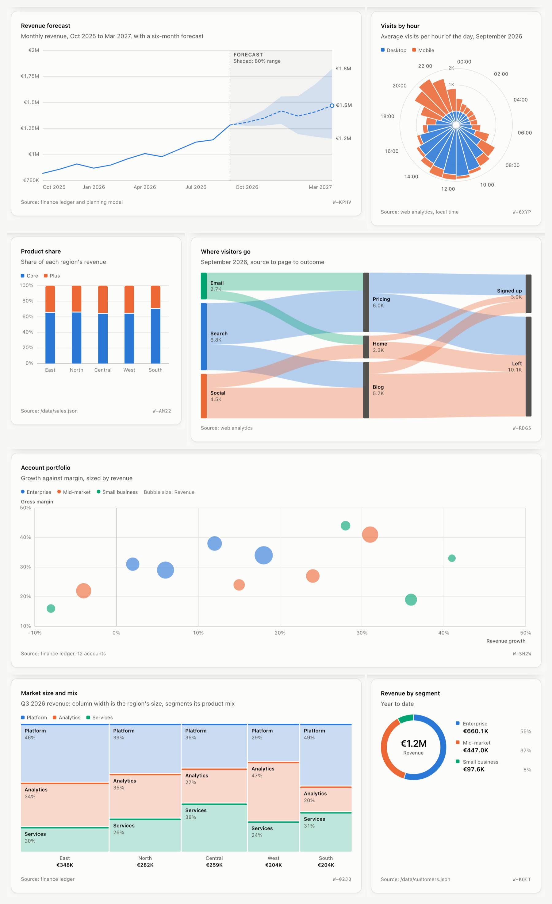

# FFT Widgets

One universal widget block that you fork into any chart, table, list or KPI.

A widget is a single plain object, the **spec**. It says where the data comes from, how to reshape it, how to draw it, and how it looks. The same spec draws in the browser, validates in Node, and is readable and editable by agents through the bundled MCP server.

```
 data          transform              fields               view              style
 where rows -> reshape rows        -> labels and formats -> how rows are  -> theme, palette,
 come from     (filter, sort,         per field            drawn            tokens, size
               aggregate, calc...)                         (table, bar...)
```

Every slot takes a **block**: `{ "type": "...", ...options }`. Blocks live in a registry, so a new data source, transform, format or view is one `register*` call, and every widget can use it.



## Quick start

Needs Node 23.6 or later (it runs TypeScript directly, with no build step).

```bash
npm install
npm run dev        # the site at http://localhost:5173
npm test           # unit and integration tests
npm run build:lib  # the drop-in bundle in dist/
npm run catalog    # the chart catalog and data guide, generated
npm run build:site # the whole site in dist-demo/, for any static server
```

## The site

The demo is <!-- pages -->12<!-- /pages --> pages, linked from one row at the top of each:

| Page | What it is |
| --- | --- |
| Gallery, Playground | Every example widget on one dashboard, and a live spec editor over it |
| Taller, Selected | New versions of any widget, and the ones worth keeping |
| Editor, Composer | A chart from a table, then a dashboard from charts, without writing JSON |
| Commercial, Client health, Regulatory | The three worked dashboards below |
| Catalog, Data guide, Drop-in | Every chart type, the table each needs, and one-tag embeds |

## Drop it into any page

`npm run build:lib` writes `dist/martcharts.iife.js` (a classic script, `window.MartCharts`) and `dist/martcharts.js` (an ES module). Both register `<fft-widget>`, so a page needs no bundler and no JavaScript of its own.

```html
<script src="martcharts.iife.js"></script>

<fft-widget data="sales.csv"></fft-widget>                   <!-- just data: the chart is picked for you -->
<fft-widget src="catalog/funnel.json"></fft-widget>          <!-- a spec file -->
```

The [chart catalog](docs/catalog.md) has all <!-- views -->57<!-- /views --> views with a spec to start from. [docs/frameworks.md](docs/frameworks.md) has recipes for React, Vue, Svelte and server-rendered apps.

## A widget in one object

```json
{
  "id": "revenue-by-region",
  "title": "Revenue by region",
  "subtitle": "Q3 2026, all products",
  "source": { "name": "Finance ledger" },
  "data": { "type": "url", "url": "/data/sales.json", "path": "data.items" },
  "transform": [{ "type": "aggregate", "groupBy": "region", "measures": [{ "op": "sum", "field": "revenue" }] }],
  "fields": { "revenue": { "label": "Revenue", "format": { "type": "currency", "currency": "EUR" } } },
  "view": { "type": "bar", "x": "region", "y": "revenue" }
}
```

`createWidget(el, spec)` draws it; `widget.update({ view: { type: "table" } })` redraws the same data as a table; `fork(spec, changes)` makes a new widget that says only what changes.

## What is built in

| Slot | Blocks |
| --- | --- |
| Data sources | `inline`, `url`, `fn`, `csv`, `sheet`; `refresh` reloads live data |
| Transforms | `filter`, `sort`, `limit`, `aggregate`, `pivot`, `calc`, `bin`, `rag` |
| Formats | `number`, `currency`, `percent`, `date`, `badge`, `spark`, `bar`, `delta`, `heat`, `rag`, `text` |
| Views | <!-- views -->57<!-- /views --> of them, grouped by question in [Which view?](#which-view) |
| Dashboards | Filters, a period control, sections, cross-filtering, links, print and an as-of line |
| Emphasis | `highlight`, `colors` and `colorRules` |
| Reading | A plain guide for every chart, in English, French or German |
| Export | CSV, PNG and SVG of the whole card, copy for Excel, and self-sizing embeds |
| Accessibility | EN 301 549 and WCAG 2.1 AA: keyboard, screen readers, contrast. See [accessibility.md](docs/accessibility.md) |
| Look | Light and dark, four presets, ten named palettes, Apple type |

Each row is described in full in [docs/features.md](docs/features.md); every option of every block is in [docs/blocks.md](docs/blocks.md).

## Which view?

| You want to show | Views |
| --- | --- |
| A number, and progress to a goal | `kpi`, `kpis`, `gauge`, `meter`, `bullet`, `rings` |
| A ranking or a comparison | `hbar`, `dot`, `dumbbell`, `slope`, `pyramid`, `radar` |
| Change over time | `line`, `area`, `bar`, `calendar`, `candlestick`, `dual`, `horizon`, `bump`, `rose` |
| Patterns across two dimensions | `heatmap`, `matrix` |
| Parts of a whole | `pie`, `donut`, `waffle`, `treemap`, `sunburst`, `icicle`, `marimekko`, `strips` |
| What makes up a change | `waterfall`, `variance`, `pareto` |
| How values spread, and how two relate | `histogram`, `boxplot`, `beeswarm`, `ridgeline`, `scatter` |
| Flows, answers and plans | `sankey`, `funnel`, `chord`, `likert`, `timeline`, `lifecycle`, `board` |
| Where things are | `choropleth`, `symbols`, `locator` |
| Status, anomalies and clients | `ragboard`, `ragtrend`, `anomalies`, `whitespace`, `xray`, `history` |
| Records to read | `table`, `list` |

Charts follow fixed rules: a colorblind-checked palette with its own dark set, hairline gridlines, a legend only for two or more series, and a data table behind every chart. What each view adds is in [docs/features.md](docs/features.md#which-view-in-detail).

## Three worked examples

Each board reads as a story: the headline, why it moved, where, and who acts.

- **Regulatory landscape** (`regulatory.html`): rules in force, the next 90 days, pressure, who must comply and where the rules bind.
- **Commercial cockpit** (`commercial.html`): the book, what needs attention, the pipeline, who could buy what, and who to call.
- **Client health** (`health.html`): every client in red, amber or green on four perspectives, each status from a written threshold.

The editor and the composer make the same from a CSV, without writing JSON; see [docs/editor.md](docs/editor.md).

## The MCP server

Every widget is linked to an MCP server, so an agent can read its data, explain it, change it or fork it.

```bash
npm run mcp                                   # all widgets in ./widgets
node src/mcp/main.ts --widget revenue-kpi     # a server linked to one widget
```

Tools list, read, create, update, validate and recommend widgets and charts; see [docs/mcp.md](docs/mcp.md).

## Documentation

Start with [docs/features.md](docs/features.md) (every feature in detail) and [docs/api.md](docs/api.md) (the spec and the JavaScript API). Generated references: [catalog](docs/catalog.md), [chart guide](docs/chart-guide.md) and [blocks](docs/blocks.md). Also: [editor](docs/editor.md), [frameworks](docs/frameworks.md), [MCP](docs/mcp.md), [accessibility](docs/accessibility.md) and the [Taller](docs/taller.md).

## Project layout

```
src/core/      spec types, registry, pipeline, formats, validation, reading layers. No DOM: runs in Node too.
src/dom/       createWidget, <fft-widget>, dashboards, the editor, the composer, export, styles and every view.
src/mcp/       widget store, MCP server, command line entry.
widgets/       stored widget specs; regulatory/, commercial/ and health/ hold the worked dashboards' widgets.
dashboards/    dashboard specs; gallery.json lays out the gallery.
demo/          the site's pages: gallery, Taller, selected, editor, composer and the three dashboards.
catalog/       one self-contained spec per view, and the pages that draw them (generated).
examples/      drop-in and embed pages that use the built bundle with no build step.
scripts/       generators for docs, the catalog and the sample data, and the site build.
```

## License

MIT. See [LICENSE](LICENSE).
